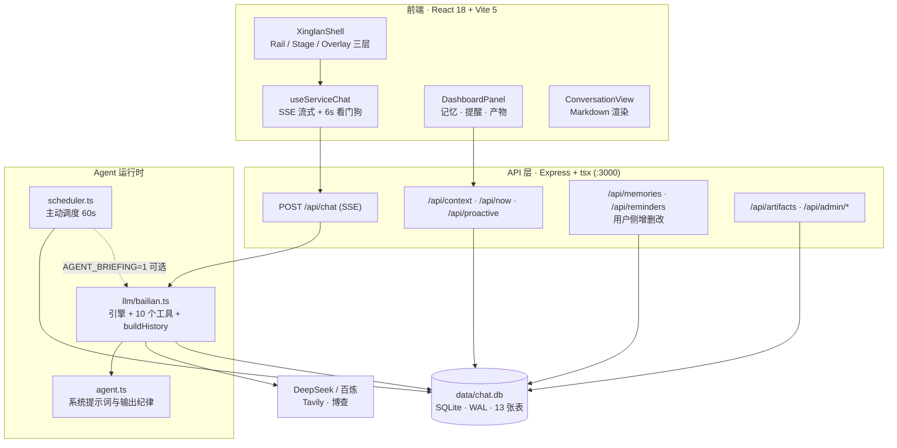
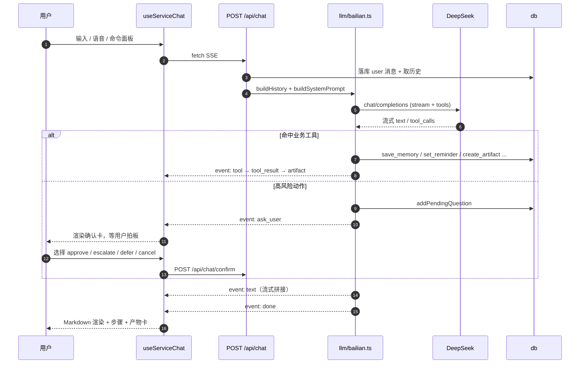
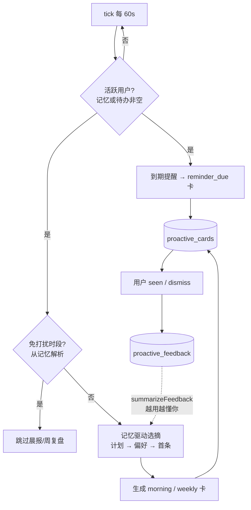
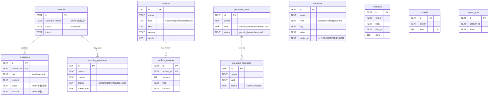

# 星澜 / 栖光·Lumen — 系统架构

> 基于 2026-10-06 代码与运行时实况重写。旧版（2026-08-15）描述的是已移除的
> CodeBuddy SDK + MCP 工具箱架构，与现状严重不符，本文已全面更新。
>
> 定位：**单用户、本地优先、对话驱动的 AI 生活管家**。差异化在「被记住的感觉」与
> 「不用你开口也替你盯着」。

---

## 1. 技术栈

| 层 | 技术 |
|---|---|
| 前端 | React 18 · TypeScript · Vite 5（dev 5173 / preview 4173，`/api` 代理到 3000） |
| 后端 | Express 4 · TypeScript · `tsx`（:3000） |
| 引擎 | **OpenAI 兼容协议**：DeepSeek（主，`deepseek-chat`）/ 百炼 DashScope（备）。实现在 `server/llm/bailian.ts` |
| 工具 | OpenAI function calling（**不是 MCP**），工具定义在 `server/llm/bailian.ts` 的 `activeToolDefs()` |
| 数据库 | better-sqlite3，单文件 `data/chat.db`，WAL + `busy_timeout=5000` |
| 联网 | Tavily / 博查（BoCha）自动择优，`server/tools/web.ts` |
| 实时 | SSE：`/api/chat` 流式对话；`/api/admin/stream` 数据变更推送 |

**已替换的执行通道 + 已收敛的工具注册表**（2026-10-06 架构审计后更新）：

- **运行时不走 SDK / MCP**：真实引擎是 OpenAI 兼容协议（`llm/bailian.ts`），工具进程内直连执行。
- **工具注册表已唯一化**：`server/tools/registry.ts` 是**唯一**一份，工具的 schema 与 handler 同处定义。
  `bailian.ts` 的 `activeToolDefs()`（下发 schema）与 `execTool()`（执行）都查表调用；
  提示词里的能力清单由 `activeToolDefs()` 派生（`buildSystemPrompt` 的**必传**参数）——三者不可能再不一致。
- `execTool()` 统一套 `withTimeout`（默认 15s，`web_lookup` 30s）+ `withRetry`（默认 2 次），
  错误以文本返回给模型自行改道，不打断会话。
- ~~`server/tools/index.ts`~~ **已删除**（含 `createSdkMcpServer` / `buildXinglanServer` / `AGENT_PRINCIPLES`）；
  `@tencent-ai/agent-sdk` 依赖**已卸载**。

**已停用 / 死代码**：

- 多 Agent 编排 `server/llm/orchestrator.ts`（`MULTI_AGENT=0` 停用，4 次调用太慢）
- `/api/check-login`（CodeBuddy 登录检测）
- `overrides` 表（只写不读）

---

## 2. 整体架构

### 三个值得注意的设计点

1. **引擎看门狗**：百炼配额耗尽时 SDK `query()` 会挂起不抛错（180s 才超时），后端 SSE 只发 init 就沉默。
   因此 `useServiceChat` 自带 **6s 无内容 → abort → 兜底 mock + 提示**的客户端看门狗，`!res.ok` 兜底在此场景下永远不触发。
2. **工具裁剪是确定性的**：`activeToolDefs()` 曾因「用户库为空就隐藏 recall_memory / get_schedule」造成鸡生蛋问题（永远没机会写入第一条记忆）。
   现已改为只按**凭证**裁剪 `web_lookup`。
3. **前端三层交互面**：Rail（常驻）/ Stage（一次只看一个，切换淡入）/ Overlay（抽屉、面板、反馈栈）。
   所有"开口"入口（输入、建议、能力、主动卡、语音）统一走 `XinglanShell.dispatch()`。

---

## 3. 一次对话的链路

SSE 事件类型：`init` `text` `tool` `tool_result` `artifact` `ask_user` `notice` `done`。
注意 `done` **不下发 `fullText`**，前端靠累加 `text` 事件还原正文。

---

## 4. 工具箱（10 个，OpenAI function calling）

| 工具 | 作用 | 落库 |
|---|---|---|
| `save_memory` | 记住偏好 / 事实 / 计划 | `memories` |
| `recall_memory` | 回看长期记忆 | 读 `memories` |
| `get_schedule` | 查看未完成待办 | 读 `reminders` |
| `set_reminder` | 新增提醒待办（幂等去重） | `reminders` |
| `checkin_mood` | 记录情绪 1-5 | `moods` |
| `ask_user` | 高风险动作前发起确认 | `pending_questions` |
| `web_lookup` | 联网检索（按已配 Key 自动选源） | 外部 |
| `create_artifact` | 创建产物（同名覆盖，幂等） | `artifacts` |
| `update_artifact` | 就地编辑（**自动快照旧版本**） | `artifacts` + `artifact_versions` |
| `open_artifact` | 只读打开产物（防凭记忆编造） | 读 `artifacts` |

`addReminder` 的语义去重：归一化后做**前缀包含**判定（`SIM_HEAD_MIN=6`）。
不能用「截取前 N 字符」——归一化会去掉括号，长句的前 N 字会被后半段占据而匹配不上。

---

## 5. 主动调度与反馈闭环

- **免打扰**：从记忆里识别「少打扰 / 免打扰」并解析时段，注意 **12 小时制换算**（晚上 11 点 = 23 点）。
- **反馈学习**：信号累计 ≥2 时生成一句提示织回简报（常划掉 →「我之后会更克制一些」）。
- 到期提醒是用户自己设的硬截止，**不受免打扰抑制**。

---

## 6. 数据模型

表清单（13）：`sessions` `messages` `memories` `reminders` `moods` `artifacts`
`artifact_versions` `proactive_cards` `proactive_feedback` `pending_questions`
`agent_runs` + **死表** `faqs` `overrides`。

**归属约定**：`owner` 字符串贯穿记忆/提醒/情绪/产物/主动卡。前端当前**硬编码 `owner='guest'`**，
且系统**无任何用户鉴权**（仅 `/api/admin/*` 支持可选 `ADMIN_TOKEN`）。自用场景，不计划做多租户。

---

## 7. API 端点

| 方法 | 路径 | 说明 |
|---|---|---|
| POST | `/api/chat` | 核心对话（SSE 流式） |
| POST | `/api/chat/confirm` | 人在环决策（approve/escalate/defer/cancel） |
| GET | `/api/context` `/api/now` | 跨会话聚合：记忆/待办/情绪；此刻聚合 |
| GET | `/api/proactive` · POST `:id/seen` `/dismiss` · GET `/feedback` | 主动卡与反馈 |
| GET/PUT/DELETE | `/api/memories/:id` · POST `/merge` `/cleanup` | 记忆增删改、合并、过期清理 |
| GET/PUT/DELETE | `/api/reminders/:id` | 提醒增删改 |
| GET | `/api/artifacts` · `/:id` · `/:id/versions` · POST `/:id` `/:id/restore` | 产物与版本回滚 |
| GET/POST | `/api/settings` · `/api/models` | 凭证自助配置、模型列表 |
| GET | `/api/check-engine` · `/api/check-web` | 引擎/联网自检（已接入设置页） |
| GET | `/api/admin/*` | 治理：画像、活动流、遥测 runs、例外收件箱 |

---

## 8. 配置与凭证

`.env`：`DEEPSEEK_API_KEY` / `DEEPSEEK_MODEL`（主）、`BAILIAN_API_KEY`（备）、
`MOCK_AGENT`（演示模式）、`TAVILY_API_KEY` / `BOCHA_API_KEY`（联网，也可来自系统环境变量）、
`AGENT_BRIEFING`（晨报是否由模型撰写）、`DEMO_SEED`（演示种子，默认关）、`ADMIN_TOKEN`（可选）。

设置页写入后**即时生效无需重启**（`settings.ts` 原子写 `.env` 并同步 `process.env`）。
判断联网可用性不要只看 `WEB_SEARCH_PROVIDER` 是否显式指定——需「任一 Key 已配即就绪」，
否则环境变量里已有的 Key 会被静默忽略。

---

## 9. 当前状态

| 能力 | 状态 |
|---|---|
| 对话主链路（含多轮历史注入） | 可用 |
| 记忆 / 提醒 可增删改、过期清理、冲突合并 | 可用（P0） |
| 主动调度：记忆驱动 + 免打扰 + 反馈学习 | 可用（P1） |
| 产物就地编辑 + 版本历史回滚 | 可用（P2 A1） |
| 人在环确认闭环 | 可用 |
| 真实引擎 | DeepSeek 可用；百炼曾因账号欠费（Arrearage）不可用 |
| 跨会话连续性 | **未实现**（新会话即失忆，路线图 B1） |
| 移动端适配 | 仅有 980/560 断点，交互仍是桌面范式 |

**已知技术债**：`faqs`（27 条死数据）、`overrides`（只写不读）、`/api/check-login` 残留。
**运行时约束**：调度器随进程运行，**进程停则主动服务停**；本地开发态下主动能力是间歇性的。

---

## 10. 构建与验证备忘

- 沙箱内 `npm run build` 会被 safe-delete 拦在清空 dist 那步，改用
  `npx tsc -b --force` + `npx vite build --emptyOutDir false`。
- 探针脚本在 `scripts/`：对话 `sse-probe`、多轮 `multiturn-probe`、产物幂等 `artifact-loop-probe`、
  记忆管控 `memory-control-probe`、主动 P1 `proactive-p1-probe`、产物版本 `artifact-version-probe`、
  记忆合并 `memory-merge-probe`。
- 本地 curl 需 `--noproxy '*'`；后台服务必须用 `run_in_background`，否则 shell 返回即被杀。

---

## 11. 与《WorkBuddy Agent 架构详解》的对齐情况

> 参考文档：`https://www.workbuddy.cn/space/d/333bhkorSZ0nF5GFczFhSK`
> （发布态 `https://workbuddy.link/p/333bhkorSZ0nF5GFczFhSK`）。原文需登录，以下对照依据
> 本项目旧文档第 13 节已记载的框架要点：分层供给、六步 ReAct 循环、Deferred 延迟加载、
> Skill 插件化、Sub-Agent 派发、MCP / 沙箱、设计原则。

| 层 | 参考架构 | 星澜现状 | 状态 |
|---|---|---|---|
| L0 入口 | 自然语言用户意图 | 前端对话 / 语音 / 命令面板 | 对齐 |
| L1 循环 | 六步 ReAct + 最大迭代 + 反思 | `bailian.ts` function-calling 循环，`MAX_AGENT_ITERATIONS=6`，注释标注"对齐六步 ReAct" | 部分（六步由模型隐式完成，无显式阶段结构，无反思步） |
| L2 工具 | 内建工具 | 10 个工具，进程内直连执行 | 对齐（但通道非 MCP） |
| L2 Deferred | 重型工具延迟加载 | `web_lookup` 按凭证裁剪，且按已配 Key 自动选源 | 对齐 |
| L2 Skill | 能力包插件化按需加载 | `server/tools/registry.ts` 唯一注册表（10 个工具，schema + handler 同处定义） | 弱（无外部 Skill 加载机制，硬编码） |
| L2 Sub-Agent | 子智能体派发 | `orchestrator.ts` 已停用；`scheduler.ts` 仅定时生成卡片 | 缺失 |
| L3 MCP | MCP 设备联动 | 运行时**不走 MCP**；MCP 构建代码已随 `tools/index.ts` 删除 | 缺失（最大分歧） |
| L3 沙箱 | 隔离运行时 + 文件分级 | Node + 单 SQLite，无分级文件体系 | 缺失 |
| L4 人环 | Human-in-the-loop | `ask_user` + `pending_questions` + 4 种决策 | 对齐 |
| L4 容错 | 错误容忍 | 客户端 6s 看门狗 + 服务端 `tryFindArtifactContent` 兜底；`execTool` 有超时 + 重试 | 部分（无供应商级 failover） |
| L4 原则 | 设计原则 + 安全分级 | `buildSystemPrompt` 输出纪律 0-11；`AGENT_PRINCIPLES` 已无人引用 | 部分（无显式安全分级表） |

### 结论

**整体"形似而神不似"**：L0 / L2 工具 / L2 Deferred / L4 人环四项实质对齐；
**L3（MCP 与沙箱）与 L2 Sub-Agent 是最大缺口**——换引擎时为了可用性，把执行通道从 MCP
退化成了进程内直连，代价是失去了"能力外设化"这一参考架构的核心优势。

若要重新对齐，代价最小的两步：
1. **补齐安全分级**：把高风险动作的判定从"模型自主判断"改为显式 risk tier 表驱动；
2. **恢复能力外设化**：`registry.ts` 已是单一注册表，下一步只需把 `run` 换成可外挂的
   handler（MCP / 子进程），即可在不改调用侧的前提下恢复"能力外设"。（工具**双份定义**的问题已解决，
   不必再考虑"把 execTool 改回调用 tools/index.ts"——那个文件已不存在。）

---

*更新于 2026-10-06，对应代码 `smart-service-agent`。*
